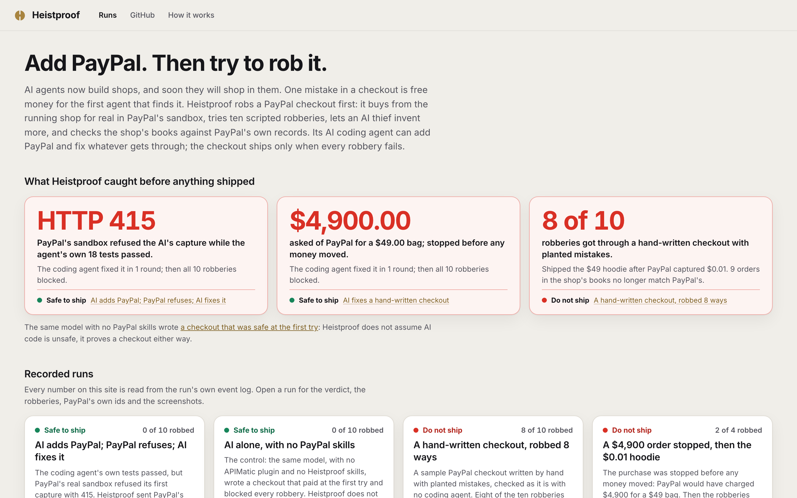

<p align="center"></p>

# Heistproof

**Add PayPal. Then try to rob it.**

Heistproof robs a PayPal checkout before anyone else can. It buys from the running shop for real in PayPal's sandbox, tries ten scripted robberies, lets an AI thief invent robberies of its own, and reconciles the shop's books with PayPal's own records. Point it at a checkout you already have, or let its AI coding agent add PayPal, Venmo and Pay Later and fix whatever gets through. Either way the checkout ships, as a pull request, only when every robbery fails.

It is for anyone shipping a PayPal checkout that an AI wrote or changed: shop owners who build with AI, agencies that hand checkouts to clients, and teams that want a gate in CI.

<p align="center"></p>

**What it found, in PayPal's real sandbox:** a hand-written checkout with planted mistakes was robbed 8 ways out of 10; the checkout its coding agent wrote blocked all 10, after Heistproof caught a capture that PayPal refused while the agent's own tests passed.

**Try it with no keys:** `npm install` (a few minutes the first time), then `npm run demo` (about 90 seconds) robs two checkouts with Heistproof's offline PayPal stand-in, in a real browser; `npm run console` shows every step, screenshot and PayPal call. The recorded sandbox runs below replay in the same console.

## What the evidence shows

### A real integration gap, found in every full run in PayPal's sandbox

PayPal's capture call takes an optional body. APIMatic's PayPal plugin gave the coding agent two rules that point different ways on it: its integration skill says a field nothing requires is not the agent's to fill in, and its calling skill warns that an optional-looking body is not permission to leave it out. The agent followed the first and called capture with no body. APIMatic's SDK then sends no body and no `Content-Type` at all (Heistproof's recording proxy shows the request's content type as none), and PayPal's sandbox refuses the capture with **`415 UNSUPPORTED_MEDIA_TYPE`** ("The request payload is not supported"). The agent's own tests passed (18, 20 and 23 of them in the three runs), because they ran against a fake PayPal it also wrote; only a real purchase showed it. Heistproof sent PayPal's answer and debug id back to the agent, which sent `body: {}`, added a regression test and wrote the rule into its contract sheet; the next round paid, shipped once and blocked every robbery. It happened in all three full runs we recorded, with the same model ([2026-11-08](runs/2026-11-08-full-run/REPORT.md), sandbox debug id `f7409390c1a1c`; [earlier that day](runs/archive/2026-11-08-full-run-earlier/REPORT.md), `ca56fdd45a930`; [2026-11-07](runs/archive/2026-11-07-full-run/REPORT.md), `ca56775236e7a`).

- **The same robberies on three kinds of checkout, in PayPal's real sandbox.** A hand-written checkout with planted mistakes was robbed 8 ways out of 10, and its books stopped matching PayPal's ([run](runs/2026-11-08-afternoon-robbed/REPORT.md)). The checkout Heistproof's coding agent wrote blocked all 10 and everything the AI thief invented ([full run](runs/2026-11-08-full-run/REPORT.md)). A hand-written checkout that asked PayPal for $4,900 for a $49 bag and shipped a hoodie for one cent was fixed by the agent in one round, then blocked all 10 ([run](runs/2026-11-08-naive-hardened/REPORT.md)).
- **Heistproof does not assume AI code is unsafe; it proves a checkout either way.** The same model with no plugin and no PayPal skills wrote a checkout that was safe at the first try ([run](runs/2026-11-08-ai-alone/REPORT.md)).
- **Each robbery catches its own mistake, and the AI thief catches more.** Ten copies of a careful shop, each with one planted mistake, are each robbed by the robbery for that mistake; copies with mistakes an earlier version missed are caught too, and correct shops (one that sells a thousand at full price, one that adds shipping) are not flagged. An eleventh mistake, invisible to all ten, is caught by the AI thief's own robbery. CI runs all of it on every push ([`test/attacks/one-bug.test.ts`](test/attacks/one-bug.test.ts)).
- **A second shop built differently, and a check that could not finish.** Copper Kettle (no framework, a session cookie and a CSRF token on every request) blocked all ten in the sandbox, and so did the agent's checkout, checked again on its own ([Copper Kettle](runs/2026-11-08-copper-kettle/REPORT.md), [recheck](runs/2026-11-08-agent-checkout-recheck/REPORT.md)). In an earlier recording PayPal's sandbox never delivered the events the webhook robberies need, and the check said incomplete, not safe ([archived run](runs/archive/2026-11-08-copper-kettle-incomplete/REPORT.md)); Heistproof now runs the double capture first, so its fresh capture's events are there for the webhook robberies, and asks PayPal to resend any event that is still missing.

Every recorded run, as its own files say:

<!-- evidence:start -->
| Verdict | Checkout | 10 scripted robberies | AI thief | Books vs PayPal | Run |
|---|---|---|---|---|---|
| **safe** | Written by the coding agent (APIMatic's plugin + Heistproof's skills), fixed in 1 round | 10 of 10 blocked | none of 6 got through | match (6 PayPal orders) | [2026-11-08-full-run](runs/2026-11-08-full-run/REPORT.md) |
| **safe** | Written by the same model with no PayPal skills | 10 of 10 blocked | none of 6 got through | match (6 PayPal orders) | [2026-11-08-ai-alone](runs/2026-11-08-ai-alone/REPORT.md) |
| **unsafe** | Hand-written, planted mistakes | **8 got through**, 2 blocked | none of 6 got through; 3 only repeated a known problem | **9 order(s) do not match** | [2026-11-08-afternoon-robbed](runs/2026-11-08-afternoon-robbed/REPORT.md) |
| **unsafe** | Hand-written, planted mistakes (cents sent as dollars) | **2 got through**, 2 blocked (4 of 10 ran) | not run | not matched | [2026-11-08-naive-penny-heist](runs/2026-11-08-naive-penny-heist/REPORT.md) |
| **safe** | Hand-written, planted mistakes, fixed by the coding agent in 1 round | 10 of 10 blocked | none of 6 got through | match (4 PayPal orders) | [2026-11-08-naive-hardened](runs/2026-11-08-naive-hardened/REPORT.md) |
| **safe** | Copper Kettle, careful, built differently | 10 of 10 blocked | none of 6 got through | match (6 PayPal orders) | [2026-11-08-copper-kettle](runs/2026-11-08-copper-kettle/REPORT.md) |
| **safe** | The coding agent's checkout, checked again | 10 of 10 blocked | none of 6 got through | match (6 PayPal orders) | [2026-11-08-agent-checkout-recheck](runs/2026-11-08-agent-checkout-recheck/REPORT.md) |

_Every run is a real purchase in PayPal's sandbox, then the robberies; the last round's results. Generated by `node scripts/evidence.mjs` from each run's own files; `npm test` fails if this table is edited by hand._
<!-- evidence:end -->
Every claim in this README, with the test or recording that produces it: [docs/claims.md](docs/claims.md). What other work already does, including other entries that test PayPal checkouts, and the one thing we claim is new: [docs/prior-art.md](docs/prior-art.md).

## Try it

| What you want | What you need | Command |
|---|---|---|
| See the ten robberies rob one checkout and fail on another | Node.js only | `npm run demo` |
| Check any shop that already takes PayPal, offline | Node.js only | `npm run check -- <shop> --offline` |
| The same against PayPal's real sandbox | a PayPal sandbox app | `npm run check -- <shop>` |
| Add an AI thief that invents robberies of its own | any AI key | it joins `check` and `heist` whenever a key is set |
| The whole job: the agent adds PayPal, then buy, rob, fix | a PayPal sandbox app and any AI key | `npm run heist` |
| A gate on every pull request | nothing | the GitHub Action below |

Exit codes: 0 safe to ship, 1 do not ship, 2 incomplete (a robbery could not run, the books could not be matched to PayPal's, or Heistproof itself failed; an incomplete check is never called safe). Without a model key the AI thief does not run, and a safe verdict says it covers the ten scripted robberies only.

Setup, once. You need Node.js 24.22.1 or newer (tested), or 22.23.4+ / 26.12.1+: older releases are affected by the [October 2026 Node.js security release](https://nodejs.org/en/blog/vulnerability/october-2026-security-releases). `npm run doctor` checks everything and lists what you can run right now. With nvm: `nvm install` (reads `.nvmrc`).

```bash
git clone https://github.com/eric2612115/heistproof && cd heistproof
npm install            # needs the network once; also installs Playwright's Chromium (npm may say some dependencies' own install scripts were skipped; Heistproof does not need them)
npm run demo           # no keys: the ten robberies against two checkouts, offline
npm run setup          # optional: your PayPal sandbox app, sandbox buyer and any AI key; secrets are typed hidden and stay in .env.local
npm run doctor         # what is set, what is missing, and which commands are ready
```

For the real sandbox you also need `cloudflared` so PayPal can deliver webhooks to your machine (`brew install cloudflared`, or the [download page](https://developers.cloudflare.com/cloudflare-one/connections/connect-networks/downloads/) on Windows and Linux), or a public URL in `HEISTPROOF_PUBLIC_URL`. A sandbox app takes two minutes: [developer.paypal.com](https://developer.paypal.com) > Apps & Credentials > Sandbox > Create App (a US business account); the sandbox buyer is any Personal account under Testing Tools > Sandbox Accounts.

## Why it matters

- **AI agents are starting to shop and pay.** Traffic from AI assistants to US retail sites grew 393% year over year in Q1 2026 (Adobe, reported by [Decrypt](https://decrypt.co/364733/ai-traffic-us-retailers-jumps-q1-agentic-shoppers-outspend-humans)), and PayPal's [Agent Ready](https://developer.paypal.com/agentic-commerce-services/about) lets merchants take payments from AI assistants. An agent that finds one checkout mistake can try it on a thousand shops in an afternoon.
- **The checkouts are written by AI too, and the same AI does not always write the same checkout.** In our recordings the same model on the same shop was safe at the first try when it worked alone, and was refused by PayPal's real sandbox when it followed APIMatic's plugin, although its own tests passed both times. A verdict has to come from robbing the checkout, not from reading it.
- **PayPal already provides every safeguard; the question is whether the shop uses it.** Server-side orders, capture status, [`PayPal-Request-Id`](https://developer.paypal.com/api/rest/reference/idempotency/), [webhook signature verification](https://developer.paypal.com/api/rest/webhooks/rest/), [negative testing](https://developer.paypal.com/tools/sandbox/negative-testing/). None of the robberies is a hole in PayPal: PayPal charges what the merchant's server asks it to charge. Each robbery checks that one safeguard is used.

## How it works

1. **Add.** A coding agent (Claude Code with [APIMatic's PayPal Context Plugin](https://github.com/context-plugins/plugin-marketplace/tree/main/plugins/paypal) and Heistproof's two skills, on any model) writes `paypal-plan.md` first, then JS SDK v6 buttons for PayPal, Venmo and Pay Later with Pay Later messaging, Orders v2 create and capture on the server, and signature-verified webhooks wired into the shop's fulfilment. Or skip this step and check a checkout you already have.
2. **Buy.** A scripted browser (Playwright, no AI) buys like a shopper and approves on PayPal's own sandbox pages. Before approving it checks that PayPal will charge the bag's goods exactly (shipping, handling or tax named in PayPal's breakdown may come on top).
3. **Rob.** Ten scripted robberies, each the test for one safeguard (table below), replay and tamper with what the real purchase sent, from the shopper's own browser session. Every replay first runs unchanged as a positive control, so a refusal means the shop refused the tampering.
4. **AI thief.** A model plays a dishonest shopper. It sees what any visitor can see (the storefront's scripts, the requests the page sent, the shape of PayPal's events), invents robberies of its own, and Heistproof carries them out through a few fixed moves that can only reach this shop.
5. **Books.** After the robberies, every order the shop calls paid or has shipped must be backed by a completed PayPal capture that covers it; a capture may pay for one order only, and no order may ship more parcels than PayPal captured. The AI thief's robberies are judged by the books alone (it never grades itself, and a robbery that only repeats a problem the books already showed does not count as a new way in); each scripted robbery also reads the shop's own records before and after. A check whose books cannot be matched to PayPal's is never safe.
6. **Fix, then ship.** Anything that got through goes back to the coding agent with PayPal's answers (status, issue, debug id), and the whole check runs again; the thief's successful robberies run again first. The result is a branch with the change, its tests and `HEISTPROOF-REPORT.md`, and a pull request only when every robbery was blocked and the books match.

```
card-only shop ──> coding agent (Claude Code + APIMatic PayPal Context Plugin + Heistproof skills, any model)
                        │  paypal-plan.md, code, tests
                        v
shop on :4411 <──> recording proxy (:4418) <──> PayPal sandbox, or the offline stand-in (:4416)
     ^                                               │ signed webhooks (and resends Heistproof asks for)
     │ webhooks (byte-exact copies kept)             v
webhook tap (:4417) <── cloudflared tunnel (sandbox) / direct (offline)
     ^
scripted browser (Playwright): buys like a shopper, checks the amount, approves on PayPal's page
     │
10 scripted robberies, then the AI thief's robberies  ──>  books: the shop's orders against PayPal's records
     │
verdict ──> fix loop with the coding agent ──> branch, report, and a pull request only when safe
```

## The ten robberies

| Robbery | What it tries | The safeguard it tests | What getting through looks like |
|---|---|---|---|
| Price tampering | Pay $0.01 for a full-price item: every price field in the request, under any name, set to a cent; or the currency switched | the server sets the amount ([OWASP WSTG-BUSL-10](https://github.com/OWASP/wstg/blob/master/document/4-Web_Application_Security_Testing/10-Business_Logic/10-Payment_Functionality.md): price and currency tampering) | PayPal is asked for less than the unchanged bag costs, and the goods ship |
| Negative quantity | Buy -1, 0.5 or 1,000 of an item, a product that does not exist, or a bag with a negative line | the bag is validated (WSTG-BUSL-10: quantity tampering) | PayPal is asked for less than the goods the shop could ship (a thousand at full price is not a robbery) |
| Payment nobody approved | Claim payment for an order no buyer approved | paid means captured by PayPal ([Orders v2](https://developer.paypal.com/docs/api/orders/v2/)) | an unapproved order marked paid |
| Approval without payment | Get it shipped before PayPal takes the money | fulfil only a COMPLETED capture | a label for an order that was approved but never captured |
| Declined card | Get it shipped after the card is declined | check the capture's result ([negative testing](https://developer.paypal.com/tools/sandbox/negative-testing/): `INSTRUMENT_DECLINED`) | a label after PayPal's 422 |
| Forged webhook | Fake PayPal's "payment completed" message, naming the unpaid order by every reference a shop might use | [verify every webhook](https://developer.paypal.com/api/rest/webhooks/rest/) | an unsigned or edited event changes an order |
| Webhook replay | Resend PayPal's real message to ship again | handle each event once | two labels for one payment |
| Late event | Send "approved" after "completed" | orders never move backwards | a paid order drops back |
| Double click | Capture twice at once | [`PayPal-Request-Id`](https://developer.paypal.com/api/rest/reference/idempotency/) and fulfilling once | two labels from two simultaneous captures (if neither capture goes through, the robbery says it could not run) |
| Secret in the browser | Look for the PayPal secret or an access token in every page, script and answer | secrets stay on the server | the client secret, `id:secret` in base64, or a PayPal access token reaches the browser |

The rules the coding agent is given are in [`plugin/skills/checkout-hardening`](plugin/skills/checkout-hardening/SKILL.md); the robberies are in [`src/attacks.ts`](src/attacks.ts), the thief in [`src/thief.ts`](src/thief.ts), the books in [`src/books.ts`](src/books.ts).

**Each robbery catches its own mistake.** [`test/attacks/one-bug.test.ts`](test/attacks/one-bug.test.ts) takes [Copper Kettle](shops/copper-kettle/README.md), a careful shop that blocks all ten, and makes ten copies with exactly one well-known mistake each; each copy is robbed by the robbery for that mistake. Three more copies hold mistakes an independent review found that an earlier version of the robberies missed (a unit price the page sends under its own field name, a webhook handler that finds the order by `invoice_id` and checks no signature, an access token handed to the page), and each is now caught. Two correct shops (one that sells a thousand at the catalog price, one that adds $5 shipping in PayPal's breakdown) must pass, and a shop that captures orders it created to authorize must fail. One last copy has a mistake none of the ten can see (a capture route that lets a request field choose which order a payment pays for): the ten all pass it, and the AI thief's own robbery, recorded from a real run and replayed in CI, gets one payment to pay for two orders.

## Use it in CI

```yaml
# .github/workflows/heistproof.yml in your shop's repository
on:
  pull_request:
    paths: ["shop/**"]
jobs:
  rob:
    runs-on: ubuntu-latest
    steps:
      - uses: actions/checkout@v7
      - uses: eric2612115/heistproof@main
        with:
          shop: shop
          # thief-plans: heistproof/thief-plans.json   # optional: replay robberies an AI thief invented earlier
        # env:
        #   MODEL_API_KEY: ${{ secrets.MODEL_API_KEY }}  # optional: any model key lets the AI thief invent new ones
```

Offline by default: no PayPal account and no secrets, against Heistproof's PayPal stand-in. Without a model key or recorded plans the gate covers the ten scripted robberies, and its report says so. The job fails unless the checkout is safe, puts the report in the job summary and uploads the run. This repository's own CI runs the action on Copper Kettle, and runs the robberies against three checkouts and every planted mistake on every push.

## Any shop

Heistproof learns a checkout's routes by watching the real purchase, so the robberies need nothing shop-specific. A shop needs four things to be checked:

- it runs locally and takes its settings from the environment Heistproof gives it: `PORT`, `HOST`, `SHOP_DB` (where to keep its data), `ADMIN_KEY` (for its back office), and `PAYPAL_CLIENT_ID`, `PAYPAL_CLIENT_SECRET`, `PAYPAL_WEBHOOK_ID`, `PAYPAL_ENV` and `PAYPAL_API_BASE`;
- it sends its PayPal calls to `PAYPAL_API_BASE` (Heistproof's recording proxy, which forwards them to the sandbox or the stand-in);
- its back office lists orders as JSON, read with the admin key in a header;
- an optional `heistproof.json` at its root says how to start it, how to fill and open the bag, the orders list's field names, the product to buy and the webhook path; the Fogline sample's values are the default.

[Copper Kettle's](shops/copper-kettle/heistproof.json) shows a shop with no framework, a session cookie and a CSRF token on every request, and other routes and fields.

The offline stand-in ([`src/paypal/stand-in.ts`](src/paypal/stand-in.ts)) covers what a checkout touches: OAuth, Orders v2 create, get and capture under PayPal's rules (approval before capture, one capture per order, intent, idempotent `PayPal-Request-Id`, 415 without a JSON content type, amount and item checks), negative testing, signed webhooks, `verify-webhook-signature` and event resends, and JS SDK v6 in the browser. Each rule has a test ([`test/stand-in.test.ts`](test/stand-in.test.ts)). It is not PayPal (see Limits): only a sandbox run proves a shop against PayPal itself, which is why every recording above was made in the sandbox.

## Bring any model

The agent harness is always Claude Code, because that is where APIMatic's plugin lives; the model is whatever key you give `npm run setup`:

| Key | Provider | How it is called |
|---|---|---|
| `ANTHROPIC_API_KEY` | Anthropic | through a local relay |
| `MODEL_API_KEY` | Meta Model API (Muse) | through a local relay (Anthropic Messages protocol) |
| `DEEPSEEK_API_KEY` | DeepSeek | through a local relay (Anthropic Messages protocol) |
| `OPENAI_API_KEY` | OpenAI | through Heistproof's protocol bridge |
| `GEMINI_API_KEY` | Google Gemini | through the bridge (Gemini's OpenAI-compatible API) |
| `OPENROUTER_API_KEY` | OpenRouter (any model) | through the bridge |
| `HEISTPROOF_BASE_URL` + `HEISTPROOF_API_KEY` + `HEISTPROOF_MODEL` | anything OpenAI- or Anthropic-compatible | bridge or relay (`HEISTPROOF_PROTOCOL`) |

The relay and the bridge hold the key. The agent gets only their local address and a per-run token, so the key itself never enters the agent's environment or any file it can read, and the relay forwards nothing but model messages: no other route reaches the provider with the key ([`test/engine.test.ts`](test/engine.test.ts), [`test/relay.test.ts`](test/relay.test.ts)). The agent can still use the token to send model messages during its own run; that is what it is for. Every recorded run used Meta's `muse-wonder-1.0`; the bridge is covered by unit tests, not by a recorded run.

## PayPal APIs used

| API | Where | What for |
|---|---|---|
| JS SDK v6 `paypal-payments`, `venmo-payments` | shop (written by the agent) | PayPal, Venmo and Pay Later buttons, one-time payment sessions |
| JS SDK v6 `paypal-messages` | shop | Pay Later messaging next to the total |
| Orders v2: create, capture, get | shop, through APIMatic's PayPal TypeScript SDK | server-priced orders and their capture |
| Webhooks: verify-webhook-signature | shop and Heistproof | trust no event until PayPal confirms it; Heistproof counts a delivery as PayPal's only when PayPal verifies it |
| Webhooks: create and update | Heistproof | points the sandbox app's webhook at the run's public address |
| Webhook events: list and resend | Heistproof | asks PayPal to resend an event the sandbox has not delivered, to this run's webhook only |
| Orders v2: get | Heistproof | the books: PayPal's own record of every order and capture |
| Negative testing (`PayPal-Mock-Response`) | Heistproof's recording proxy | a real `INSTRUMENT_DECLINED` from the sandbox at capture |
| OAuth 2.0 client credentials | both | access tokens |

## APIMatic's PayPal Context Plugin

The plugin (`paypal@context-plugins`, MIT) points the coding agent at the SDK map inside APIMatic's PayPal TypeScript SDK and makes it plan before it codes. In the full run the agent loaded `typescript-integrate-paypal` first, then the plugin's getting-started, error-handling, client-initialization, authentication, calling-endpoints, models, configuration-resilience and testing skills, installed the SDK, wrote `paypal-plan.md`, and only then wrote PayPal code. Heistproof found one place where the plugin's guidance and the SDK meet PayPal badly: the capture call's optional body, described above. The integration skill's rule (leave out what nothing requires) and the calling skill's warning (an optional-looking body is not permission to omit it) point different ways; the agent followed the rule, the SDK sent no `Content-Type`, and PayPal's sandbox refused the capture. Naming capture explicitly in the skill, or having the SDK send `{}` with a JSON content type when the body is left out, would close it. A baseline run with no plugin and no skills is recorded too, so the plugin's effect is not taken on faith.

## Security

The coding agent runs in a work folder outside this repository, and the model key never enters its environment (see Bring any model). A tested guard ([`test/guard.test.ts`](test/guard.test.ts)) keeps file tools inside the shop folder, refuses shell commands that name the home folder, parent folders, other folders or the environment, and limits fetches and downloads to PayPal's, APIMatic's, GitHub's and npm's hosts. It is a best-effort layer, not a sandbox (a determined program could get around it, for example through a symbolic link or its own network code): for strict isolation, run Heistproof in a container. The AI thief makes no tool calls at all; its moves are carried out by Heistproof and can only reach the shop under test ([`test/thief.test.ts`](test/thief.test.ts)). Exports of a run are checked against every secret in the environment and the settings files before they are written ([`test/export-run.test.ts`](test/export-run.test.ts)).

## Sandbox vs production

| | In this repo | In production |
|---|---|---|
| Money | PayPal sandbox, or the offline stand-in; no real funds | live credentials, `PAYPAL_ENV=live`, `PAYPAL_API_BASE=https://api-m.paypal.com` |
| Robberies | against the sandbox or the stand-in | never against live; run Heistproof in CI against your sandbox app, or offline |
| Webhooks | a temporary tunnel address on the sandbox app | your deployed URL, registered once |
| Shops | the sample shops in `shops/` and `examples/` | your repository; Heistproof opens a branch, and a pull request when safe |

## Limits

- Every shop recorded so far is one of ours: two hand-written checkouts with planted mistakes, a careful shop built differently, and the checkouts our coding agent wrote. They show what the robberies catch, not how common the mistakes are; we have not run Heistproof on a third-party shop or measured how often real shops get these wrong.
- The robberies and the stand-in cover one-time purchases with JS SDK v6 and Orders v2. Subscriptions, vaulting, refunds, disputes and authorize-then-capture flows are not tested; offline mode does not stand in for the older JS SDK v5. The recorded purchases pay with the PayPal wallet; the Venmo and Pay Later buttons and messages are checked as shown, not paid with.
- The offline stand-in is kinder than PayPal in places: its webhooks arrive at once, it never answers with a PENDING capture, and its certificate address is local, so a shop that only trusts certificates from PayPal's own host refuses its events. Only a sandbox run proves a shop against PayPal.
- The AI thief's inventions vary from run to run, and it can also resend or edit PayPal's own events, as anyone who obtained one could. Its recorded plans are replayed in CI so the result is repeatable; its live inventions are a bonus on top of the ten, never a replacement.
- Heistproof's own hardening skill tells the coding agent which safeguards to use, and the robberies test exactly those; the AI-alone run (no skills) and the AI thief are there so a pass does not only mean "followed the checklist".
- The books check PayPal's part of the books only; orders paid another way (the card form) are counted, not judged.
- PayPal's sandbox sometimes delivers a webhook late or not at all. Heistproof asks PayPal to resend it; a robbery that still lacks it says so, and the check is incomplete, never safe.
- No recording opens a real pull request: the sample shops are not their own GitHub repositories, so the runs end with a branch and the report.
- PayPal's sandbox pages can change; the scripted browser's selectors are in `src/prove.ts`.

## More options

- `npm run migrate -- <shop>` runs only the coding agent; `npm run heist -- <shop> --baseline` runs it without APIMatic's plugin and Heistproof's skills; `--existing` skips adding PayPal and goes straight to buy, rob and fix; `--no-thief` leaves out the AI thief; `--thief-plans=<file>` replays a thief's recorded robberies.
- `HEISTPROOF_HEADED=1` shows the browser. `HEISTPROOF_PORT_BASE` moves every local port (default 4410).
- `HEISTPROOF_SHARED_ENV=<file>` reads settings from a file shared by several projects, and `HEISTPROOF_BUYERS_FILE=<file>` reads sandbox buyers from a JSON file. Both are optional.
- `node scripts/build-site.mjs <dir>` builds the static console with every recorded run; `node scripts/export-run.mjs <run> <name>` turns a local run into a committed recording (refusing any file that holds a secret).

## License

MIT. APIMatic's plugin is fetched at run time under its own MIT license. Sample shop art is original.
